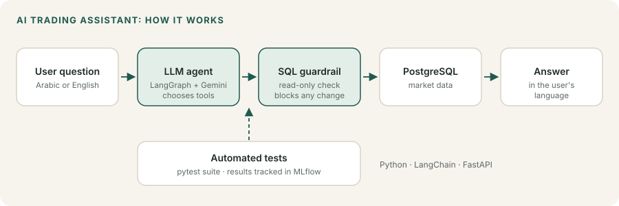
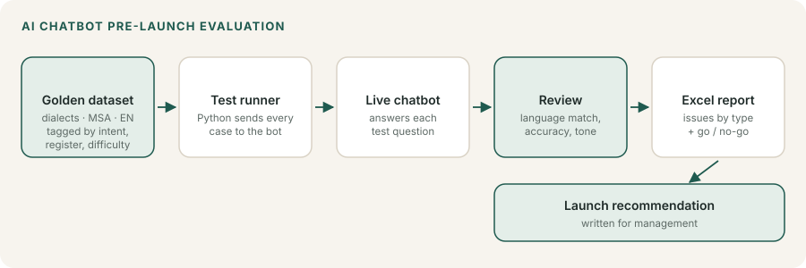
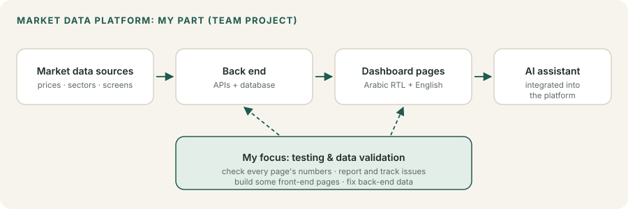
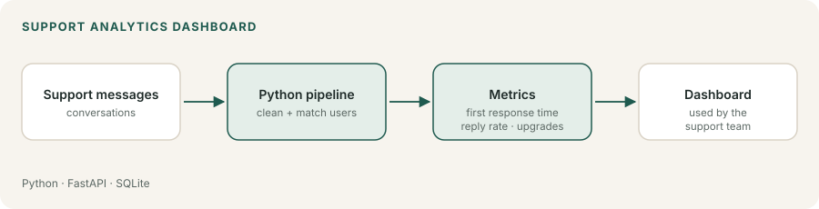
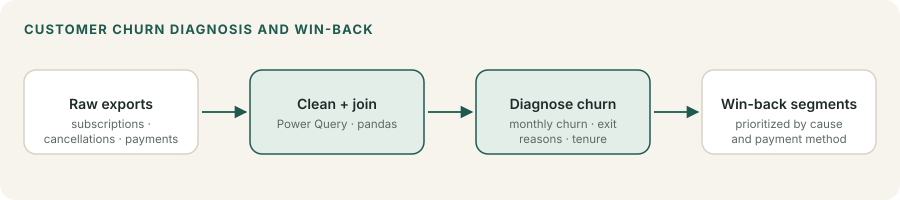
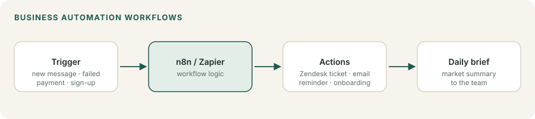

# Work Case Studies

Selected projects from my current role as **Data Analyst & AI Evaluation Specialist** (since Feb 2026).

The code, data and internal figures belong to my employer and are confidential, so this repo contains **write-ups only**: the problem, my role, the approach and the tools. My public code is in my other repositories.

---

## 1. AI Trading Assistant

**Problem:** Members asked many repeat questions about market data that already lived in a database.
**My role:** Developer on a small team building a bilingual (Arabic + English) assistant. Worked across the whole project: design, prompts, tools, testing and integration.
**Approach:**
- The assistant turns a question into safe, read-only SQL, runs it, and answers in the user's language.
- Guardrails block any query that could change data.
- Automated tests check answer accuracy, with results tracked in MLflow.

**Tools:** Python, LangChain / LangGraph, Gemini, PostgreSQL, FastAPI, MLflow, pytest

➡️ **Public code version:** [bilingual-market-assistant](https://github.com/accnadashaban-png/bilingual-market-assistant)

## 2. Customer-facing AI chatbot: training data & pre-launch evaluation

**Problem:** The company was about to launch an AI support bot and needed proof that it was ready.
**My role:** Built the test data and ran the evaluation.
**Approach:**
- Built a golden evaluation dataset in Arabic dialects, MSA and English, tagged by intent, register, test type and difficulty.
- Wrote a Python runner that sends every test case to the live bot and produces an Excel report.
- Found a language-mismatch issue (the bot sometimes answered in the wrong language) and wrote the go / no-go recommendation for management.

**Tools:** Python, Excel, prompt writing, LLM evaluation

➡️ **Public code version:** [arabic-chatbot-eval](https://github.com/accnadashaban-png/arabic-chatbot-eval)

## 3. Market data platform: QA, front end & data (team project)

**Problem:** A bilingual web platform for screening and filtering market data.
**My role:** Team contributor across testing, front end and back-end data.
**Approach:**
- **Main focus: testing and evaluation.** Tested the dashboard pages and checked that the data on each page was correct, then reported and tracked the issues.
- Built some front-end pages with AI-assisted development.
- Fixed and corrected data on the back end.
- Integrated the AI assistant into the platform.

**Tools:** AI-assisted development, JavaScript / front end, REST APIs, SQL, manual and exploratory QA

## 4. Support Analytics Dashboard

**Problem:** The support team had no clear view of response speed or of how support affected upgrades.
**My role:** Built the tool; the team uses it internally.
**Approach:**
- Collects support conversations and computes first response time, reply rate and upgrades after support.
- Presents the results in a simple dashboard.

**Tools:** Python, FastAPI, SQLite

➡️ **Public code version:** [customer-support-analytics](https://github.com/accnadashaban-png/customer-support-analytics)

## 5. Customer churn diagnosis & win-back segments

**Problem:** Subscribers were cancelling, and the company needed to know why and whom to win back first.
**My role:** Analyst.
**Approach:**
- Cleaned and joined raw cancellation, subscription and payment exports.
- Measured monthly churn, exit reasons and tenure, and identified the main driver of permanent losses.
- Built prioritized win-back segments by exit cause and payment method, and reconciled member access against payment history.

**Tools:** Excel (Power Query, pivots), Python (pandas)

## 6. Market data pipelines
**Approach:**
- Python pipelines pull stock data from Interactive Brokers, FMP and TradingView.
- They compute beta and volatility, and classify sectors and themes with an LLM.

**Tools:** Python, pandas, REST / WebSocket APIs, LLMs

## 7. Business automation

**Approach:**
- n8n and Zapier workflows route support messages to Zendesk tickets.
- Others send cancellation reminders and failed-payment emails, handle onboarding, and produce a daily market brief.
- Set up GA4 and UTM tracking, and wrote playbooks for traffic and reach issues.

**Tools:** n8n, Zapier, Zendesk, GA4

## 8. Dashboard QA review (bilingual market dashboard)
**Problem:** A bilingual (Arabic + English) market-data dashboard needed a careful check before release.
**My role:** Tester. Ran an exploratory review and wrote the findings report.
**Approach:**
- Tested every dashboard section in both languages and checked displayed numbers against the API.
- Documented 19 issues with annotated screenshots, grouped into bugs, content, Arabic wording and usability.
- Examples: counters showing loaded items instead of real totals, plus/minus signs flipping in right-to-left mode, English names breaking inside Arabic text, hard-coded strings in translation files, duplicated content and Arabic spelling fixes.

**Tools:** Manual and exploratory QA, browser dev tools, API checks, RTL / i18n testing

## 9. Community content backup tool
**Problem:** The team needed an offline copy of course and report content published on its community platform.
**My role:** Built the tool.
**Approach:**
- A Python script reads every post in a space through the platform's admin API (read-only; it never edits or deletes).
- Downloads videos, PDFs and documents and names each file after its post title, numbering multi-part videos so they stay together.
- Skips files that already exist, so re-runs are cheap and safe; can render text-only posts to PDF; paces requests to respect the API.

**Tools:** Python, REST API, requests, Playwright

---

🌐 [nadashaaban.com](https://nadashaaban.com) · 📫 acc.nadashaban@gmail.com · [LinkedIn](https://www.linkedin.com/in/nada-shaban-048297206)
